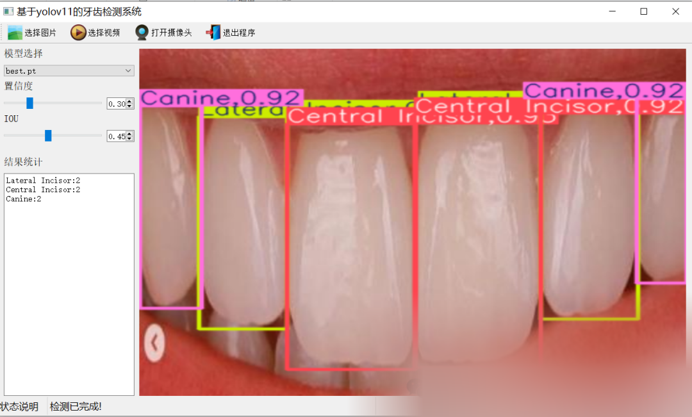
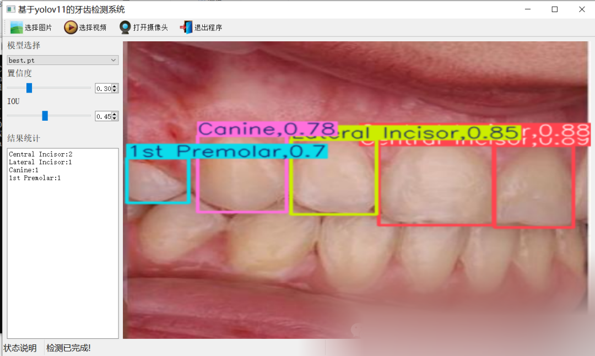
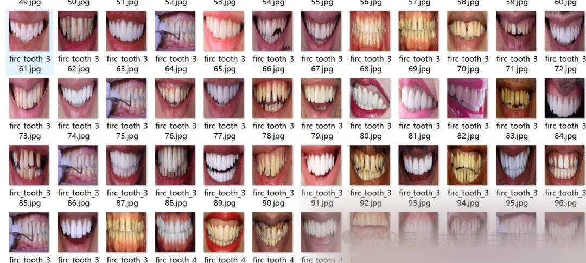
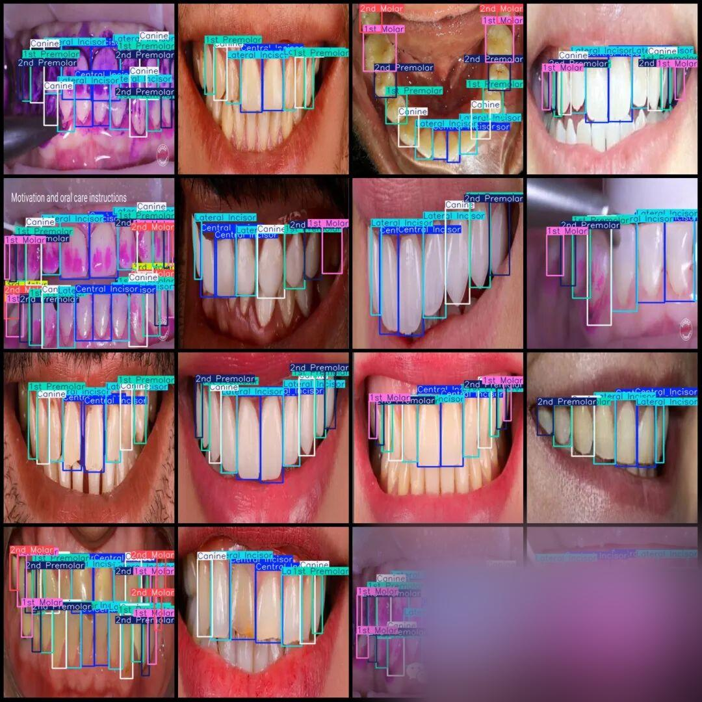

# Teeth Detection System Based on Yolov11 in Python Source Code + PyTorch Model + Evaluation Indicator Curve + High-quality GUI Interface

[Algorithm Introduction]

The Tooth Detection System based on YOLOv11 is an intelligent oral analysis tool that integrates efficiency and precision. It supports target detection and classification of eight types of teeth, including the first molar (1st Molar), the first premolar (1st Premolar), the second molar (2nd Molar), the second premolar (2nd Premolar), the third molar (3rd Molar), the canine (Canine), the central incisor (Central Incisor), and the lateral incisor (Lateral Incisor). The system utilizes the YOLOv11 deep learning framework, enhanced feature extraction modules, and optimized neck architecture to achieve high-precision recognition of complex oral imaging. Its model achieves an mAP value of over 95% on the validation set.

The system supports images. Video and real-time camera detection modes, And equipped with a visual interface. Can display the target position in real time. Confidence and total detections. Its lightweight design is suitable for edge device deployment. Under GPU acceleration, it can achieve millisecond-level response. Meeting dental clinics, Real-time demand for large-scale screening and other scenarios. Through deep convolution optimization and channel attention mechanism. The system effectively reduced the false-positive rate. Provide a more reliable quantitative basis for oral health assessment.

[Effect Display]

Editor



[Test Environment]

windows10
anaconda3+python3.8
torch==2.3.0
ultralytics==8.3.81

The model can detect the category.

First molar (1st Molar), First premolar (1st Premolar), Second molar (2nd Molar), Second premolar (2nd Premolar), Third molar (3rd Molar), Canine (Canine), Central incisor (Central Incisor), Lateral incisor

[Training Dataset Introduction]

Dataset format: Pascal VOC format + YOLO format (txt file without split path, only contains jpg images and corresponding VOC format xml files and yolo format txt files)

Number of images (number of jpg files): 2001

Number of annotations (number of xml files): 2001

Number of annotations (number of txt files): 2001

Annotation category count: 8

Label the category name (note that the order of categories in YOLO format does not correspond to this.) (Based on the labels folder's classes.txt file): ["1st Molar"] "1st Premolar", "2nd Molar", "2nd Premolar", "3rd Molar", "Canine", "Central Incisor", "Lateral Incisor"]=>["First molar", "First premolar" "Second molar" "Second premolar" "Third molar" "Canine teeth" "Middle incisor" "Lateral incisor"]

Number of boxes labeled in each category:

1st Molar Frame Count = 1514

1st Premolar Frame Count = 4062

2nd Molar Frames = 442

2nd Premolar Frame Count = 3390

3rd Molar Frame Count = 292

Canine Frame Count = 4666

Central Incisor Frame Count = 5067

Lateral Incisor Frame Count = 4938

Total frames: 24371

Using labelImg:

Annotation rules: Draw a rectangle around the category.

Important Notice: No

Special : This dataset does not guarantee the accuracy or precision of the trained models or weight files. The dataset is provided with accurate and reasonable annotations only.

Image Preview:



Annotation example:



[Training Information]


Parameters


Value


Number of training set images


1200


Number of images in the validation set


801


Training map


96.2%


Training Accuracy


94.1%


Training recall rate


92.9%


[Validation set accuracy statistics]


Class


Images


Instances


P


R


mAP50


mAP50-95


all


201


2296


0.941


0.929


0.962


0.746


1st Molar


77


136


0.857


0.765


0.893


0.628


1stPremolar


176


381


0.96


0.955


0.987


0.793


2ndMolar


21


31


0.894


0.903


0.927


0.637


2ndPremolar


148


305


0.893


0.898


0.96


0.729


3rdMolar


15


19


0.993


0.947


0.952


0.529


Canine


200


448


0.972


0.978


0.992


0.864


CentralIncisor


201


494


0.986


0.994


0.995


0.907


LateralIncisor


200


482


0.974


0.995


0.994


0.883


[Interface Design]

```
class Ui_MainWindow(QtWidgets.QMainWindow):
signal = QtCore.pyqtSignal(str, str)
def setupUi(self):
self.setObjectName("MainWindow")
self.resize(1280, 728)
self.centralwidget = QtWidgets.QWidget(self)
self.centralwidget.setObjectName("centralwidget")
self.weights_dir = './weights'
self.picture = QtWidgets.QLabel(self.centralwidget)
self.picture.setGeometry(QtCore.QRect(260, 10, 1010, 630))
self.picture.setStyleSheet("background:black")
self.picture.setObjectName("picture")
self.picture.setScaledContents(True)
self.label_2 = QtWidgets.QLabel(self.centralwidget)
self.label_2.setGeometry(QtCore.QRect(10, 10, 81, 21))
self.label_2.setObjectName("label_2")
self.cb_weights = QtWidgets.QComboBox(self.centralwidget)
self.cb_weights.setGeometry(QtCore.QRect(10, 40, 241, 21))
self.cb_weights.setObjectName("cb_weights")
self.cb_weights.currentIndexChanged.connect(self.cb_weights_changed)
self.label_3 = QtWidgets.QLabel(self.centralwidget)
self.label_3.setGeometry(QtCore.QRect(10, 70, 72, 21))
self.label_3.setObjectName("label_3")
self.hs_conf = QtWidgets.QSlider(self.centralwidget)
self.hs_conf.setGeometry(QtCore.QRect(10, 100, 181, 22))
self.hs_conf.setProperty("value", 25)
self.hs_conf.setOrientation(QtCore.Qt.Horizontal)
self.hs_conf.setObjectName("hs_conf")
self.hs_conf.valueChanged.connect(self.conf_change)
self.dsb_conf = QtWidgets.QDoubleSpinBox(self.centralwidget)
self.dsb_conf.setGeometry(QtCore.QRect(200, 100, 51, 22))
self.dsb_conf.setMaximum(1.0)
self.dsb_conf.setSingleStep(0.01)
self.dsb_conf.setProperty("value", 0.25)
self.dsb_conf.setObjectName("dsb_conf")
self.dsb_conf.valueChanged.connect(self.dsb_conf_change)
self.dsb_iou = QtWidgets.QDoubleSpinBox(self.centralwidget)
self.dsb_iou.setGeometry(QtCore.QRect(200, 160, 51, 22))
self.dsb_iou.setMaximum(1.0)
self.dsb_iou.setSingleStep(0.01)
self.dsb_iou.setProperty("value", 0.45)
self.dsb_iou.setObjectName("dsb_iou")
self.dsb_iou.valueChanged.connect(self.dsb_iou_change)
self.hs_iou = QtWidgets.QSlider(self.centralwidget)
self.hs_iou.setGeometry(QtCore.QRect(10, 160, 181, 22))
self.hs_iou.setProperty("value", 45)
self.hs_iou.setOrientation(QtCore.Qt.Horizontal)
self.hs_iou.setObjectName("hs_iou")
self.hs_iou.valueChanged.connect(self.iou_change)
self.label_4 = QtWidgets.QLabel(self.centralwidget)
self.label_4.setGeometry(QtCore.QRect(10, 130, 72, 21))
self.label_4.setObjectName("label_4")
self.label_5 = QtWidgets.QLabel(self.centralwidget)
self.label_5.setGeometry(QtCore.QRect(10, 210, 72, 21))
self.label_5.setObjectName("label_5")
self.le_res = QtWidgets.QTextEdit(self.centralwidget)
self.le_res.setGeometry(QtCore.QRect(10, 240, 241, 400))
self.le_res.setObjectName("le_res")
self.setCentralWidget(self.centralwidget)
self.menubar = QtWidgets.QMenuBar(self)
self.menubar.setGeometry(QtCore.QRect(0, 0, 1110, 30))
self.menubar.setObjectName("menubar")
self.setMenuBar(self.menubar)
self.statusbar = QtWidgets.QStatusBar(self)
self.statusbar.setObjectName("statusbar")
self.setStatusBar(self.statusbar)
self.toolBar = QtWidgets.QToolBar(self)
self.toolBar.setToolButtonStyle(QtCore.Qt.ToolButtonTextBesideIcon)
self.toolBar.setObjectName("toolBar")
self.addToolBar(QtCore.Qt.TopToolBarArea, self.toolBar)
self.actionopenpic = QtWidgets.QAction(self)
icon = QtGui.QIcon()
icon.addPixmap(QtGui.QPixmap(":/images/1.png"), QtGui.QIcon.Normal, QtGui.QIcon.Off)
self.actionopenpic.setIcon(icon)
self.actionopenpic.setObjectName("actionopenpic")
self.actionopenpic.triggered.connect(self.open_image)
self.action = QtWidgets.QAction(self)
icon1 = QtGui.QIcon()
icon1.addPixmap(QtGui.QPixmap(":/images/2.png"), QtGui.QIcon.Normal, QtGui.QIcon.Off)
self.action.setIcon(icon1)
self.action.setObjectName("action")
self.action.triggered.connect(self.open_video)
self.action_2 = QtWidgets.QAction(self)
icon2 = QtGui.QIcon()
icon2.addPixmap(QtGui.QPixmap(":/images/3.png"), QtGui.QIcon.Normal, QtGui.QIcon.Off)
self.action_2.setIcon(icon2)
self.action_2.setObjectName("action_2")
self.action_2.triggered.connect(self.open_camera)
self.actionexit = QtWidgets.QAction(self)
icon3 = QtGui.QIcon()
icon3.addPixmap(QtGui.QPixmap(":/images/4.png"), QtGui.QIcon.Normal, QtGui.QIcon.Off)
self.actionexit.setIcon(icon3)
self.actionexit.setObjectName("actionexit")
self.actionexit.triggered.connect(self.exit)
self.toolBar.addAction(self.actionopenpic)
self.toolBar.addAction(self.action)
self.toolBar.addAction(self.action_2)
self.toolBar.addAction(self.actionexit)
self.retranslateUi()
QtCore.QMetaObject.connectSlotsByName(self)
self.init_all()
```

[Common Evaluation Parameters Introduction]

In the task of object detection, evaluating the performance of a model is crucial. The terms you mentioned are commonly used metrics for assessing the performance of a model. Here are detailed explanations of these terms:

1.

1. **Class**

:

-

-

This usually refers to the categories of objects that the model is designed to detect. For example, a model may be trained to detect different categories of objects such as vehicles, pedestrians, or animals.

-

1.

1. **Images**

:

-

-

Represents the number of images in the validation set. The validation set is a dataset used to evaluate model performance, separate from the training set to ensure fairness in evaluation results.

-

1.

1. **Instances**

:

-

-

The total number of target objects in all images. This includes the sum of all category objects, for example, if the validation set contains 100 images, each image has an average of 5 target objects, then Instances is 500.

-

1.

1. **P (Precision)**

:

-

-

Precision is the proportion of actual positive samples predicted by the model. The formula is: Precision = TP / (TP + FP), where TP represents true positives (True Positives) and FP represents false positives (False Positives).

-

1.

1. **R (Recall)**

:

-

-

Recall is the proportion of all true positives correctly predicted by the model. The formula is: Recall = TP / (TP + FN), where FN represents false negatives.

-

1.

1. **mAP50**

:

-

-

Mean Average Precision (mAP) at an IoU threshold of 0.5, where IoU is the metric used to measure the degree of overlap between predicted bounding boxes and ground truth bounding boxes. mAP is a comprehensive metric that considers both precision and recall when evaluating model performance across different recall levels. At an IoU of 0.5, if the overlap between the predicted bounding box and the ground truth bounding box reaches or exceeds 50%, it is considered correct.

-

1.

1. **mAP50-95**

:

-

-

This represents the average accuracy of the model across IoU values ranging from 0.5 to 0.95 (with a step of 0.05). This is a more stringent evaluation criterion, demanding higher overlap between predicted bounding boxes and ground truth boxes. In object detection tasks, higher IoU thresholds mean that models need to be more accurate in their target object localization. The computation of mAP50-95 takes into account multiple IoU thresholds ranging from lenient to strict, thus providing a more comprehensive assessment of the model's performance.

-

These indicators collectively form an important framework for evaluating the performance of target detection models. By comparing the performance of different models on these indicators, It can be determined which model may be more effective in practical applications.

[Usage Steps]

Usage Steps:
1. Install the YOLOv11 environment according to the official framework ultralytics installation tutorial, and install PyQt5.
2. After switching to the YOLOv11 environment you have installed, and switch to the source code directory, execute python main.py to start the interface, and perform the corresponding operations.

[Provided Files]

Python source code
YOLOv11n.pt model
Training map, P, R curves (in weights\results.png)
Test images (under test_img folder)

Please provide the training dataset, and you can find the address in mytxt.txt file.


## Payment

Here is a pay link on Stripe ( https://buy.stripe.com/3cs8yP7sY87d0vu9AB ). Please contact me lonlonago@foxmail.com after funding $89, and I will send you a complete data files , thank you!


